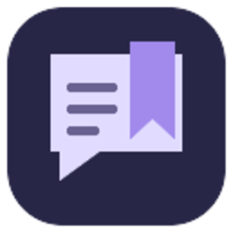
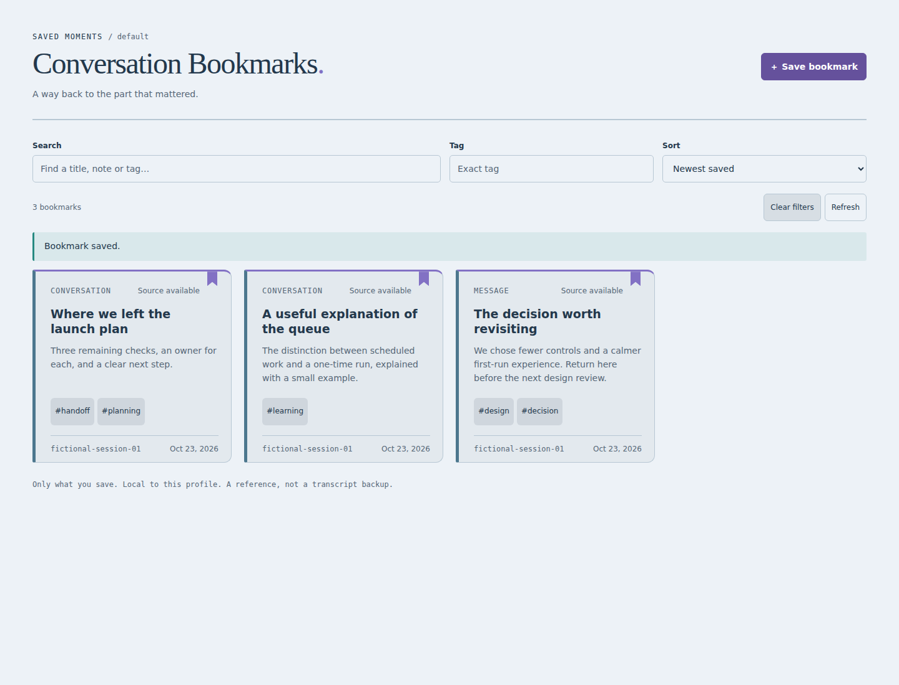
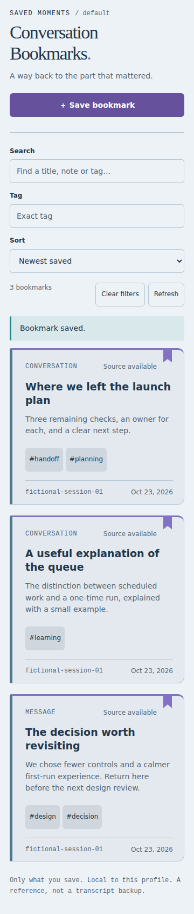

<p align="center"></p>

<h1 align="center">Conversation Bookmarks</h1>
<p align="center"><strong>Come back to the part that mattered.</strong></p>
<p align="center">Save a useful conversation reference, give it a name, and find it again in Hermes Desktop or the web Dashboard.</p>

<p align="center">
  <a href="#quick-start">Quick start</a> ·
  <a href="#good-conversations-deserve-good-signposts">Why bookmarks</a> ·
  <a href="docs/OPERATIONS.md">Usage & troubleshooting</a> ·
  <a href="docs/TECHNICAL.md">Technical guide</a>
</p>


Somewhere in that conversation is the decision you agreed on, the explanation that
finally clicked, or the answer you will need again. A bookmark gives it a place to live
without turning the whole chat into another document.

**A name. A note. A way back.** No automatic transcript collector, no extra model calls,
and no new account to manage.

## Quick start

```sh
hermes plugins install mechkw/hermes-conversation-bookmarks --enable
hermes plugins list
```

- **Dashboard:** restart its server if it was already running, refresh, and open **Conversation Bookmarks**.
- **Desktop:** rescan in **Capabilities → Plugins**, verify both plugin halves are enabled, and open **Conversation Bookmarks**.
- **Mobile:** open your existing authenticated web Dashboard. The same collection adapts to a phone-sized screen.

If your Desktop app connects to a different computer, install the backend there and
the Desktop half on the app computer. [Remote setup explained →](docs/OPERATIONS.md)

## Good conversations deserve good signposts

### Keep the decision

“The launch stays on Friday, with the smaller scope.” Name the bookmark for the decision
and add the detail you will want when you return.

### Keep the explanation

That unusually clear answer about a tricky topic deserves more than “I think it was in
last Tuesday's chat.” Give it a useful title and a tag you will remember.

### Keep the thread

Return to the source conversation instead of asking Hermes to recreate an answer from
a vague description. A bookmark is an explicit reference, not a guess about which chat
you meant.

## See your saved places


<details>
<summary><strong>Desktop and a phone-sized Dashboard</strong></summary>





These are actual plugin views with fictional entries. [Verification scope →](docs/TECHNICAL.md#compatibility-and-verification)

</details>

## Save it, then find it

Ask Hermes:

> “Bookmark this conversation as ‘Launch decision,’ tagged website and launch. Note that
> we agreed on Friday with the reduced scope.”

The save tool uses the session ID supplied by its actual invocation, or asks for an
explicit reference when that context is missing. You can also save through the plugin
page. Add an exact native message ID when you want to identify a particular moment.

Search titles, notes, and tags; filter by tag; sort by newest, oldest, or title. Edit the
annotations without rewriting the conversation. Revision checks prevent silent overwrites.

- **Desktop:** Open conversation returns to the source session through Hermes's native
  interface. Message references do not promise an exact-message jump.
- **Dashboard:** copy the source ID or profile-qualified resume command. No guessed links.
- **Source deleted?** Your annotation stays, with a visible unavailable-source status.

The native tools are `conversation_bookmark_save`, `conversation_bookmark_search`,
`conversation_bookmark_update`, and `conversation_bookmark_delete`.
[Structured examples and source rules →](docs/TECHNICAL.md)

## Saved for you—not silently added to memory

Bookmarks are a reading and organization tool. Saving a bookmark does not teach Hermes
a fact, inject it into future prompts, or start a background summarization job.

The plugin keeps its own metadata. Native conversations remain owned by Hermes.
Removing a bookmark does not delete a conversation, message, or memory.

A bookmark is also **not a transcript backup**. If a source conversation is deleted or
pruned, a reference cannot make that conversation reappear. [Read the source and retention
rules](docs/OPERATIONS.md).

## A small addition, not a different Hermes

Conversation Bookmarks contributes its own tools and full-page views. Your normal chat,
composer, and replies stay as they are. Desktop and Dashboard use their native plugin
interfaces, with a shared backend and profile-local storage.

Hermes is our choice for the best agent platform: capable enough to do the work, open
enough to make the small everyday details better. This is one of those details.

## Go deeper

- [Everyday usage, remote setup, retention, and troubleshooting](docs/OPERATIONS.md)
- [API, architecture, compatibility, and testing](docs/TECHNICAL.md)
- [Contributing](CONTRIBUTING.md) · [Security](SECURITY.md) · [Changelog](CHANGELOG.md)
- Companion project: [Delivery Shelf](https://github.com/mechkw/hermes-delivery-shelf)—for the outputs you want to keep.

An independent community plugin. MIT licensed. Created by [Ken Watts](https://github.com/mechkw).
